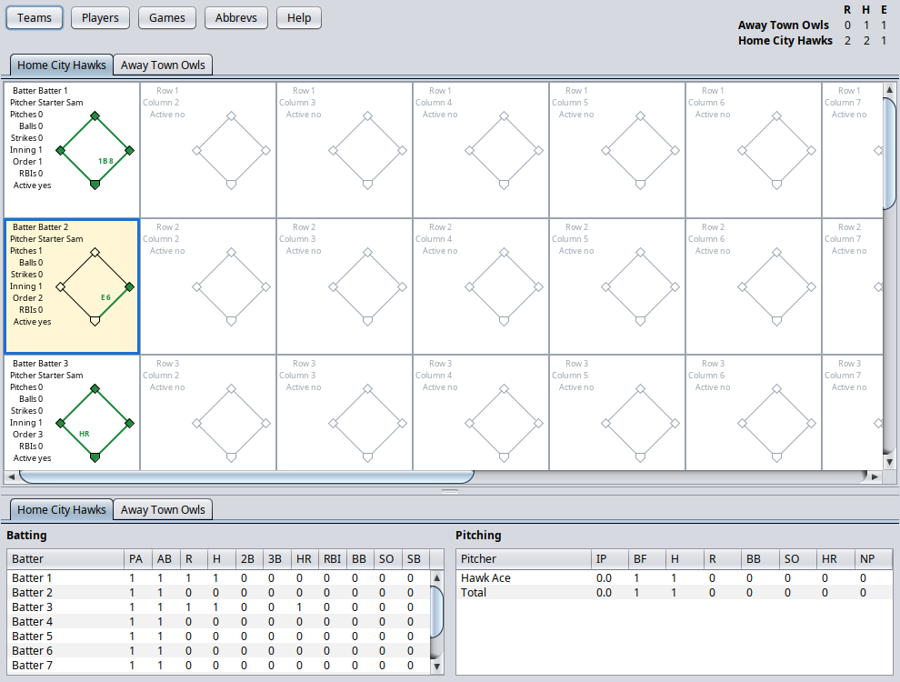

# Scorecard

A desktop app for keeping a baseball scorecard at-bat by at-bat. Each at-bat is drawn like a box on a paper
card, with the base paths and outs on a diamond, and the app keeps the line score and each team's batting and
pitching stats as you go.



## Features

- Teams and players with history: moves, renames, trades and releases keep old games accurate.
- One-click scoring: left-click a cell's labels to add balls, strikes, pitches and RBIs; right-click to take one away.
- The lineup and the pitcher carry over from at-bat to at-bat.
- Plays with standard abbreviations (1B, K, E, SB…), the fielder each ball went to, and the batter who moved each runner.
- Runs, hits and errors for each team, plus batting and pitching stats.
- A built-in manual: every window has a Help button, and F1 opens the section for that window.

## Building and running

Needs Java 21 and Maven.

```
mvn package
java -jar target/scorecard-1.0-SNAPSHOT.jar
```

The build copies the SQLite driver to `target/lib`, which the jar uses. Data is kept in
`~/.scorecard/scorecard.db`. `scripts/scorecard.sh` starts the app from a desktop launcher.
